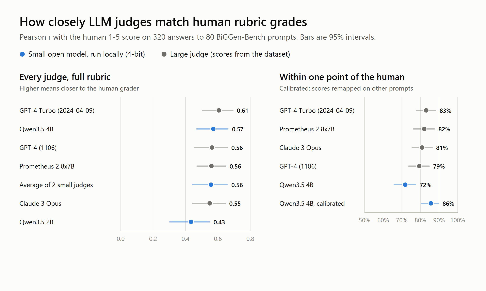

# Can a small local model grade like a human rubric grader?

**Short answer: on correlation, yes.** Qwen3.5 4B, 4-bit, running on a 4 GB GeForce GTX 1050 Ti,
tracks human rubric grades as closely as GPT-4, Claude 3 Opus and Prometheus 2 did as judges
in BiGGen-Bench. The catch is calibration: it grades harsher than people do, and a simple
remapping learned on other prompts fixes most of that.



| Judge | Pearson r [95% CI] | Weighted kappa | Exact | Within 1 | Bias |
|---|---|---|---|---|---|
| GPT-4 Turbo (2024-04-09) | 0.61 [0.50, 0.69] | 0.59 | 39% | 83% | -0.05 |
| **Qwen3.5 4B, local** | **0.57 [0.47, 0.66]** | 0.55 | 40% | 72% | -0.41 |
| GPT-4 (1106) | 0.56 [0.46, 0.66] | 0.55 | 38% | 79% | -0.12 |
| Prometheus 2 8x7B | 0.56 [0.47, 0.65] | 0.45 | 34% | 82% | +0.18 |
| Claude 3 Opus | 0.55 [0.44, 0.65] | 0.52 | 34% | 81% | -0.02 |
| Qwen3.5 2B, local | 0.43 [0.30, 0.55] | 0.38 | 38% | 62% | -0.73 |
| Qwen3.5 4B, calibrated | 0.57 [0.46, 0.67] | 0.50 | 29% | 86% | +0.00 |

320 answers to 80 prompts. Bias is the mean of judge minus human score, so below 0 means harsher.
Full tables, including per-capability numbers, are in [results/tables.md](results/tables.md).

What the numbers say:

- **Qwen3.5 4B is level with the large judges on correlation.** Paired on the same answers, it is
  0.03 below GPT-4 Turbo (95% interval -0.10 to +0.03) and within 0.03 of GPT-4, Claude 3 Opus
  and Prometheus 2. None of those gaps is distinguishable from zero on this sample.
- **Size matters below 4B.** Qwen3.5 2B is 0.12 to 0.18 lower than every large judge, and those
  gaps are significant.
- **Small judges are harsh.** Qwen3.5 4B scores 0.41 points below the human on average, and 2B
  0.73. That is why the 4B lands within one point of the human only 72% of the time, against 79%
  to 83% for the large judges.
- **Calibration fixes the harshness, at a price.** Mapping each judge score to the average
  human score for that judge score (learned on other prompts, 5-fold) removes the bias and lifts
  within-one agreement to 86%, on par with GPT-4 Turbo's 83%. Exact matches drop from 40% to 29%,
  because averages pull scores toward the middle of the scale. Which trade is right depends on
  whether you need rankings, rough grades or exact grades.
- **No length bias showed up** for the local judges (the correlation of answer length with judge
  minus human was +0.02 for 4B). The large judges leaned slightly the other way (-0.07 to -0.15).
- **Speed:** 10.2 s per answer for 4B and 4.1 s for 2B on the GTX 1050 Ti, including about 90
  tokens of feedback. The whole 4B run took under an hour.

## The question

Teams that train and evaluate language models grade a lot of answers against rubrics. Large
models are often used as judges to speed that up. This project asks how close small open
models, small enough to run on a 4 GB laptop-class GPU, get to the human grades, how they
compare with large judges like GPT-4 and Claude 3 Opus, and which parts of the judge prompt
actually matter.

## Data

[BiGGen-Bench](https://huggingface.co/datasets/prometheus-eval/BiGGen-Bench) (Kim et al., 2024)
has prompts in 8 capabilities, each with its own rubric: a one-line criterion plus a
description of what a 1, 2, 3, 4 and 5 look like, and a reference answer. Its
[results set](https://huggingface.co/datasets/prometheus-eval/BiGGen-Bench-Results) includes a
human-eval split where people scored 2,780 answers (695 prompts, each answered by
Llama-2-13B, Mistral-7B-Instruct, Mixtral-8x7B-Instruct and GPT-3.5-Turbo) on that 1-5 rubric.
The same rows carry the scores four large judges gave: GPT-4 (1106), GPT-4 Turbo (2024-04-09),
Claude 3 Opus and Prometheus 2 8x7B.

This project samples 10 prompts from each capability with a fixed seed (80 prompts, all 4
answers each, 320 answers). On the full split GPT-4 Turbo reaches Pearson r = 0.63 with the
humans and 0.61 on the sample, so the sample is representative.

## Judges

Qwen3.5 4B (2.7 GB) and Qwen3.5 2B (1.3 GB), 4-bit (Q4_K_M GGUF from unsloth), run with llama.cpp
(CUDA 12.4 build b11514) on a GeForce GTX 1050 Ti with 4 GB of memory, temperature 0, thinking
turned off. The runner also supports Ministral 3 3B and Gemma 4 E2B; those runs are not done yet.

## Judge prompt

The judge sees the task, the rubric with all five level descriptions, and the reference answer,
writes up to 80 words of feedback, then ends with `[RESULT] N`
([judge/prompts.py](judge/prompts.py), condition `full`). The shared parts come first and the
answer last, so llama.cpp can reuse the cached prefix.

[judge/prompts.py](judge/prompts.py) also defines three variations that change one thing each:
no feedback before the score (`score_only`), only the one-line criterion with a generic 1-5 scale
(`criteria_only`), and no reference answer (`no_reference`). They are not run yet; the results
above all use `full`.

## Metrics

Per judge, on the answers it returned a score for ([judge/analyze.py](judge/analyze.py)):
Pearson and Spearman correlation with the human score, quadratic weighted kappa, exact and
within-one agreement, bias (mean judge minus human: below 0 means harsher than the human), and
length bias (Spearman correlation of answer length with judge minus human: above 0 means longer
answers get extra credit). The 95% intervals come from 2,000 bootstrap resamples of whole
prompts, so the 4 answers to a prompt stay together. Differences between two judges are
bootstrapped on paired resamples.

## Run it

```bash
python -m venv .venv && .venv/Scripts/pip install -r requirements.txt
# llama.cpp release b11514 (win-cuda-12.4-x64 plus its cudart zip) unzipped to tools/llama-cuda/
# the four GGUF files above in models/
python -m judge.data                                         # downloads the split, writes data/sample.parquet
python -m judge.run --judge qwen3.5-4b --condition full      # scripts/run_all.sh runs every judge and condition
python -m judge.analyze                                      # results/summary.json and results/tables.md
python -m judge.chart                                        # results/agreement.png
```

Each run appends to `results/raw/<judge>__<condition>.jsonl` (score, the judge's full output,
timings) and resumes if stopped. The raw outputs are committed, so the analysis can be
rerun without a GPU.

## Limits

- One human score per answer, so there is no human-vs-human ceiling to compare against.
- Two local judges and one prompt so far. The prompt variations and the other two small models
  are the next runs.
- On a GPU shared with a desktop, other apps can push the model partly out of video memory and
  slow it about 5x. The runner restarts llama-server when that happens; it does not change the
  scores.
- 320 answers: the intervals are wide, about ±0.1 on Pearson r. Small differences between
  judges are not meaningful; the paired comparisons say which ones are.
- The answers come from 2023-2024 models, and the large-judge scores are from 2024 model
  versions. Newer large judges would likely do better.
- All prompts and rubrics are in English.

## License

Code: Apache 2.0. BiGGen-Bench is CC BY-SA 4.0; the data is downloaded from Hugging Face,
not redistributed here.
